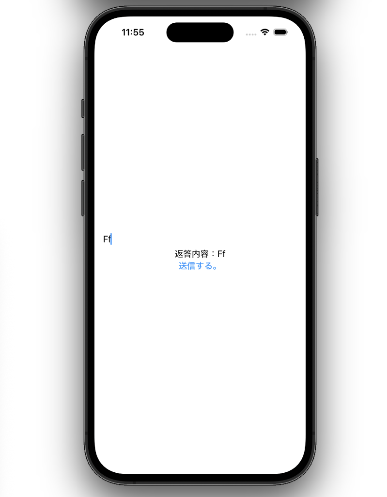

<h1 align=center> gRPC TLS Practice </h1>
<p align=center>
	A project for practicing TLS implementation using gRPC
</p>

# Usage
please install `rustls-cert-gen` ([rcgen](https://crates.io/crates/rustls-cert-gen))

```zsh
brew install rustls-cert-gen
```

and run following command.

```zsh
% rustls-cert-gen -o=./cert --cert-file-name=server --ca-file-name=root --san=127.0.0.1 --common-name=127.0.0.1
```

After running command above, root and server certificates and private keys are generated in `./cert`.

(If you clone this repository, don't push private key!)
```zsh
cert.key.pem
cert.pem
server.key.pem
server.pem
```

then you should put `cert.key.pem` and `cert.pem` at `./echoServer/cert`.


## Use Client using Xcode

You should use certificate in DER format if you use custom CA certificate, so run above command to get `cert.der`.

```zsh
openssl x509 -in root.pem -inform PEM -out root.der -outform DER
```

After you get it, put it at `./echoClient/echoClient`.

open `echoClient.xcodeproj`, press `command` + `r` to run.

This is a simple client. if you fill some words in textfield, push '送信する。' button, and get same text, TLS connection has been established successfully!




## verify certificate 
if you don't have Xcode but want to check certificate verification, run ` % curl -v --cacert ./cert.pem https://127.0.0.1:50051` after running server.

if you get such log, TLS connection has been established successfully!

```zsh
51
*   Trying 127.0.0.1:50051...
* Connected to 127.0.0.1 (127.0.0.1) port 50051
* ALPN: curl offers h2,http/1.1
* (304) (OUT), TLS handshake, Client hello (1):
*  CAfile: ./cert.pem
*  CApath: none
* (304) (IN), TLS handshake, Server hello (2):
* (304) (IN), TLS handshake, Unknown (8):
* (304) (IN), TLS handshake, Certificate (11):
* (304) (IN), TLS handshake, CERT verify (15):
* (304) (IN), TLS handshake, Finished (20):
* (304) (OUT), TLS handshake, Finished (20):
* SSL connection using TLSv1.3 / AEAD-CHACHA20-POLY1305-SHA256 / [blank] / UNDEF
* ALPN: server accepted h2
* Server certificate:
*  subject: CN=127.0.0.1
*  start date: Jan  1 00:00:00 1975 GMT
*  expire date: Jan  1 00:00:00 4096 GMT
*  subjectAltName: host "127.0.0.1" matched cert's IP address!
*  issuer: C=BR; O=Crab widgits SE
*  SSL certificate verify ok.
* using HTTP/2
* [HTTP/2] [1] OPENED stream for https://127.0.0.1:50051/
* [HTTP/2] [1] [:method: GET]
* [HTTP/2] [1] [:scheme: https]
* [HTTP/2] [1] [:authority: 127.0.0.1:50051]
* [HTTP/2] [1] [:path: /]
* [HTTP/2] [1] [user-agent: curl/8.7.1]
* [HTTP/2] [1] [accept: */*]
> GET / HTTP/2
> Host: 127.0.0.1:50051
> User-Agent: curl/8.7.1
> Accept: */*
> 
* Request completely sent off
< HTTP/2 200 
< content-type: application/grpc
< grpc-status: 12
< content-length: 0
< date: Mon, 12 Oct 2026 14:25:43 GMT
< 
* Connection #0 to host 127.0.0.1 left intact
```

# Tech Stack

### Client
- Language
	- Swift
- Framework
	- SwiftUI
- Package
	- grpc-swift-protobuf
	- grpc-swift-nio-transport
### Server
- Language
	- Rust
- Libraries
	- tonic
	- prost
	- tonic-prost
	- tokio
### Tools
- RCGen
